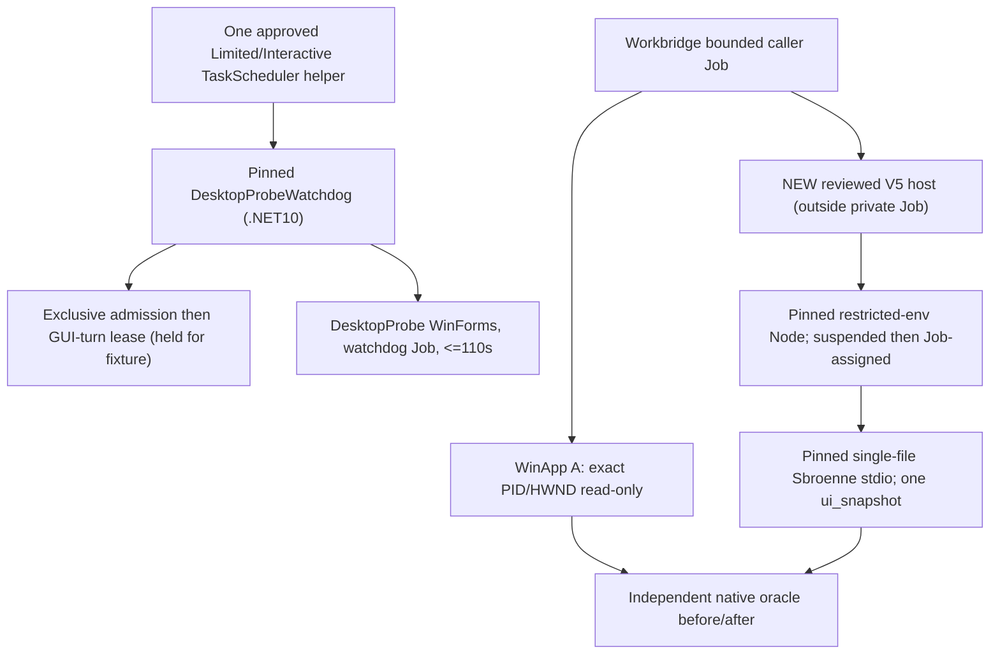

# M3-P10 — Exact-target read-only Sbroenne UIA pilot: gated contract (2026-11-05)

**Decision: 🟢 source-only contract ready; 🔴 NO LIVE GUI/UIA AUTHORIZATION.** This is a runnable *gate checklist* for a future separately approved host-only DesktopProbe comparison, not instructions to execute immediately. No new window, Task Scheduler registration, UIA `tools/call`, desktop focus/input, screenshots, live lease/sidecar edit, RIFT/VM input or production Workbridge update occurred during this design.

## Why M3-P9 is not a desktop verdict

Pinned Sbroenne `v1.3.28` single-file (`655b9fc92d03ad52a270067c6844ea1231c90559`, 59,893,792 bytes, SHA `ce18a73e6bdf5d82df8880c36de245936a698ff1a4ba50fbb759163819343128`) passed one restricted-environment **MCP `tools/list` only** trial: job `wda_m3p9_vendor_restricted_protocol_smoke_20261105_a01`, actual native OS0, Job0, 1.328-second host lifetime, zero private extraction/scratch entries. The server advertised exactly one `ui_snapshot`; nobody called it. This is **not UIA performance, desktop accuracy, foreground safety or proof of no extra-file/escaped process side effects**.

WinApp incumbent `0.7.1`: the separate Nov 4 Explorer taskbar 10/10 read-only result (median 3,677ms) is **not DesktopProbe**. Nov 5 M1 taskbar paired experiment produced **0 valid pairs**, aborted with potentially in-flight child UNKNOWN; standalone 5,357ms list / 20,367ms inspect do **not** establish candidate comparative latency. Must reconcile any unknown child/desktop turn before reattempt. Do not use taskbar for Sbroenne head-to-head: pinned Sbroenne enumerator filters it, whereas exact HWND snapshot may not; discovery capabilities differ.

## Architecture: two independent process lifetime owners



The existing deployed Workbridge desktop integration stays intact. The watchdog alone owns/releases its two GUI locks after proving its *fixture* private Job active **1→2→1** and exact child exit, with an independent **110-second** monotonic deadline. Read-only A/B samplers consume the watchdog immutable lease; they **must not reacquire, clear, rewrite or release** it. B separately owns a child-only private Job and must prove Node + MCP server and permitted console helpers all settle to **Job Active=0** before trusting a success receipt. Workbridge outer Job must be bounded and not treated as a replacement for the native Host/fixture Job proofs.

## Canonical same-target contract: neither title nor current HWND alone is identity

A and B must receive the *same* newly written immutable manifest:

`temp/desktopprobe-<runId>/evidence/target-manifest.json`, schemaVersion1, fresh runId=requestId, unique leaseId, watchdogPid + watchdogStartedAtUtcTicks **string**, fixture pid + startedAtUtcTicks **string**, sessionId, ownerSid, HWND **decimal string**, foregroundHwnd **nonzero decimal string**, className, fixed title `Workbridge GUI-004 Native Input Probe`, exact `temp/desktopprobe-<runId>/publish/DesktopProbe.exe` and SHA256, evidenceDir, observedAtUtc, deadlineUtc, jobActiveAfterSpawn=2. The watchdog publishes only after native `starting→shown`. Keep unique **sampleId per attempt** separate from the fixed watchdog runId/requestId/leaseId; write audit files `wx` (never overwrite/retry uncertain sampleId).

Required GUI stamp in `.tools/desktop-evidence/desktop-input-turn.lock`: schema1, kind `workbridge.gui-turn`, producer `desktopprobe-watchdog`, exact runId/requestId/leaseId and owner pid/startTicks/session, target kind `window` with PID/HWND null and process `DesktopProbe`. The *other* shared admission `desktop-turn-admission.lock` and all `desktop-turn-quarantine-*.json` must be separately checked **before** watchdog starts; only its native owner acquires/relinquishes its own lock handles. Never infer safety from an absent filename alone.

Admission for both providers: fixture process age **≤65s**; manifest observed age **≤65s**; watchdog remaining **≥30s** at initial validation and **≥15s** immediately before dispatch. For B's first real one-shot, adopt a stricter proposed **≥60s remaining at initial admission** to budget three native observers, stdio startup, 12s snapshot, close and Job settlement; report as an additional B policy, not an A/B latency advantage. If full sample + teardown no longer fits remaining deadline, fail blocked without a provider call. Foreground **must be nonzero and unchanged**, but need not equal the fixture HWND; the probe's *launch itself* can move focus, requiring Joey's explicit quiet-window agreement.

Every `prototypes/Observe-DesktopProbeReadOnly.ps1` call is independently enforced: current user SID/session equals target owner, WinSta0/Default desktop, top-level window `GetAncestor(GA_ROOT)==HWND` and `GW_OWNER==0`, visible/nonminimized, stable bounds/monitor, exact PID/start ticks/full exe path+SHA/class/title, and native `native-probe-<pid>.jsonl` has **exactly 2 `starting`, `shown` events, counter0, no extra input/error/reset/close**. Before/after compare journal SHA, rect, foreground, PID/start/session/HWND and lease. No `SetForegroundWindow`, activation, click, keyboard, clipboard or capture.

## A/B operation contract (after separate GO, one sample each first)

| Requirement | A — incumbent WinApp 0.7.1 | B — candidate Sbroenne v1.3.28 |
| --- | --- | --- |
| Executable | Existing `node.exe prototypes/winapp-desktopprobe-sample.mjs --target <manifest> --sample-id <unique>`; internal `winapp.exe` literal | **Not yet implemented:** separately SHA-pinned `Sbroenne-RestrictedSnapshot-Host-V5.exe snapshot <manifest> <unique>`, own reviewed V5 Node sampler, reuse proven restricted Unicode child launcher/Job; NOT V4 protocol host |
| Discovery | `--version`, `ui list-windows -a <PID> --json` | Independent native oracle + MCP `listTools` verifies sole `ui_snapshot`; exact HWND passed without window list |
| Read-only UIA | `ui inspect -w <HWND> --depth 1 --json`, per-CLI child bound 7s | `client.callTool({name:'ui_snapshot',arguments:{windowHandle:'<decimal HWND>',maxDepth:1,mode:'full',includeDiagnostics:false}}, timeout=12000ms)`; MCP server internal timeout 10s; never `ui_read` (OCR can screenshot), batch, find, input, capture or daemon |
| Native checks | 2 observers: before/after (8s each) | 3 observers: before, pre-dispatch, after (old B sampler uses 12s each); no raw UIA export |
| Tree acceptance | Exactly 1 `IncrementButton:Button`, `ResetButton:Button`, `CounterDisplay:Text/Label`; known selector + PID/HWND | MCP `success:true`, `action:'get_tree'`, `kind:'full'`, `snapshotIncomplete!==true`; exactly one correct typed `automationId` for all three; failure is incomplete/NA, never implicitly success |
| Output | Minimal structural node/depth/count+hash; no names/value | Same minimal privacy-preserving projection; bounded raw payload in private memory only, never print arbitrary names/click coordinates/text/values/diagnostics |
| Cleanup proof | Source A receipt says `processTreeSettlement:not-proven`; independent watchdog proves fixture settlement | Native V5 host only emits final success after exit0 + Node/server PID membership + full private Job0, receipt digest and private extraction inventory; watchdog independently proves fixture settlement |

Pinned upstream `UISnapshotTool.cs` SHA `6cec1c7e640e4ccb1a69bc288a293f35e126ac09ef880c9f59ee856cc1a894fe` marks `ui_snapshot` read-only and accepts an explicit decimal `windowHandle`. Omitted windowHandle falls back to *foreground*—forbidden here. One-time `mode:'full'` is appropriate; `maxDepth:1` **limits returned depth, not necessarily all provider work**, and may omit required controls because WinApp/Sbroenne depth definitions differ. **Do not silently deepen the second provider's scan to make it pass:** record `STRUCTURAL_NONCOMPARABLE`, review both configurations and get a separate approved retest. Reject diff/reset mode, incomplete scans, multiple target windows, extra/missing/incorrect typed controls. Do not compare differing structural-SHA algorithms as an equal hash; compare validated fixture IDs and per-provider counts.

B cannot simply enable V4's disabled dispatch: V4 compiles to protocol-only, old `sbroenne-desktopprobe-sample.mjs` pins the **obsolete 304-file** server and old host. New V5 must inherit **exact V4 single-file hash/size/sole directory, restricted sorted seven-key Unicode child environment** (SDK default-env key merge occurs inside restricted Node), owner-only per-sample extraction/scratch, no ambient credentials, suspended Node→private Job→resume, independent server PID+image/job census, and fail-closed OS code. Native stdout fixed-grammar `READY:<pid>`, `RESULT:success:READONLY_SNAPSHOT_VERIFIED:<receiptSha>`, `HOST:SETTLED:0`; only after a bounded, exclusive `wx` redacted receipt SHA is verified **and** Job0. No raw MCP tree or arbitrary vendor stderr/stdout to Workbridge. Design does not assert outside-Job sidecars or .NET global extraction absent without separate evidence.

## Runnable STOP/GO gate checklist for coordinator (all currently unchecked)

- [ ] **G0 — Production unchanged:** fresh Workbridge owner/health/command capacity read-only; previously interrupted M1 WinApp child/status independently reconciled; no other GUI producer or uncertain task. Keep `dist`, `.local`, RIFT and VMware unchanged.
- [ ] **G1 — Watchdog recovery:** source-sidecar requestId fix and archive parser synthetic green **but remaining crash-orphan admission-only/admission+guard recovery still has no approved live operator path**. Review exact FileId/quiescence/owner-safe recovery gates; do not rely on 6/6 private NTFS synthetic alone. Fresh lock, admission and all sidecars observation must be clear; stop if any foreign/unknown ownership.
- [ ] **G2 — Quiet desktop and permission:** Joey explicitly approves one centered 700×410 WinForms disposable window possibly changing foreground; identify current *host* foreground owner/session and avoid active physical RIFT/VMware/game dialogs, sensitive apps and competing user input. No automatic focus restoration.
- [ ] **G3 — Fresh immutable target:** unique unallocated runId/helperId/task/registration/evidence, hash-pinned DesktopProbe exe+DLL/watchdog manager; Scheduled Task current SID **Interactive/Limited**, no AtLogon/restart; watchdog sole private Job owner, ≤110s deadline; target manifest/lease/observable journal and exact HWND top-level UID pass native checks. Workbridge caller session **must equal** target SID/session or block—historical worker session2 vs target session1 cannot be assumed equivalent.
- [ ] **G4 — One A first:** execute only existing WinApp sampler in fresh <=90s bounded Workbridge job with its exact target manifest and unique sampleId, then two native observer receipts, no actions/capture. Inspect actual job OS code and redacted receipt. Record `success/blocked/unknown_outcome`, no automatic retry.
- [ ] **G5 — A fixture teardown:** watchdog child exact exit and Job **2→1**, both exclusive locks released only if verified settlement, TaskScheduler identity/status reconciled, remove **only owned** task after settlement; keep task registration and hashes/journal. If uncertain, preserve guard/quarantine and stop.
- [ ] **G6 — B implementation NEW/peer GO:** isolated V5 provider binaries/sources + immutable pins + private dirs/complete minimal output whitelist + three native observers, independent source/ABI/security review, compile/JS syntax + synthetic no-UI tests. **No live B until root authorizes a separate quiet-window sample.** No `wincli` background service.
- [ ] **G7 — One B after A approval:** fresh watchdog fixture or, if safe budget permits, same owned fixture; exact new PID/HWND/manifest, lease and foreground. B own native Job no generic Workbridge callback, one `ui_snapshot` only. Once dispatched, any error, timeout, before/after mismatch or missing Job0 = `unknown_outcome` rather than success.
- [ ] **G8 — Paired decisions:** only after independent A and B trials both clean, approve one A/B or B/A **on the exact same fresh fixture identity** within ≤110s; if insufficient time, record unpaired/censored and wait for separately consented new fixture. Never use stale HWND. Later 10 (5 each), then 30 samples in alternating A/B/B/A blocks across **multiple** watchdog lifetimes if measurement merits it; no parallel GUI agents.
- [ ] **G9 — Publish comparative SITREP:** show cold startup/connect, discovery, provider-only tree latency, native before/preDispatch/after time, close/Job settlement, full wall time, tree completeness, foreground/journal deltas, refusal/timeout/unknown rates. Explicitly state A has **2** observers and B **3**, so totals are not apples-to-apples; old Explorer taskbar and protocol-only durations are separate baselines. No provider replacement until meaningful proven wins and production rollback plan.

### Future invocation templates — deliberately NOT executable yet

A (existing tested source, only after G0–G3):
```text
Workbridge terminal_run:
  executable=C:\Program Files\nodejs\node.exe
  cwd=C:\work\workbridge-mcp
  args=[
    C:\work\workbridge-mcp\investigations\windows-desktop-automation\prototypes\winapp-desktopprobe-sample.mjs,
    --target, C:\work\workbridge-mcp\investigations\windows-desktop-automation\temp\desktopprobe-<newRunId>\evidence\target-manifest.json,
    --sample-id, <newSampleId>
  ]
  timeoutSeconds<=90
```

B (**future source-only placeholder; V5 binary and sampler DO NOT EXIST**, must pass G6 and get separate approval):
```text
Workbridge terminal_run:
  executable=<hash-pinned ignored Sbroenne-RestrictedSnapshot-Host-V5.exe>
  cwd=C:\work\workbridge-mcp
  args=[snapshot, <absolute same fresh target-manifest.json>, <newSampleId>]
  timeoutSeconds=min(75, floor((watchdogDeadline-now-15000)/1000))
  result acceptance: exact native exit0 + bounded redacted receipt SHA + Job0
```

The first approved B run should use a **fresh dedicated** ≤110s fixture unless parent can prove enough time for A then B on one; dedicated A/B are functional tests, not a same-HWND matched speed pair. Never use blanket task cleanup, restart production or clear an unknown GUI lock. Any changed foreground/journal, absent end-state or imperfect process settlement is a reason to **STOP and preserve original evidence**.

## Next engineering deliverable after coordinator review

Port old B's native observer/strict tree projection to a **separately owned V5** sampler that calls exactly one `ui_snapshot`, retaining V4 restricted-signed executable/Node source/private-Job semantics; add parser/unit tests for missing/duplicated IDs, `snapshotIncomplete`, text leakage, latency phase tags and malformed/oversized MCP output. Independently source-audit before any no-GUI synthetic tests and **explicitly seek a new GUI permission gate** before a live tool call. Source-only planning cannot establish a real desktop result.
